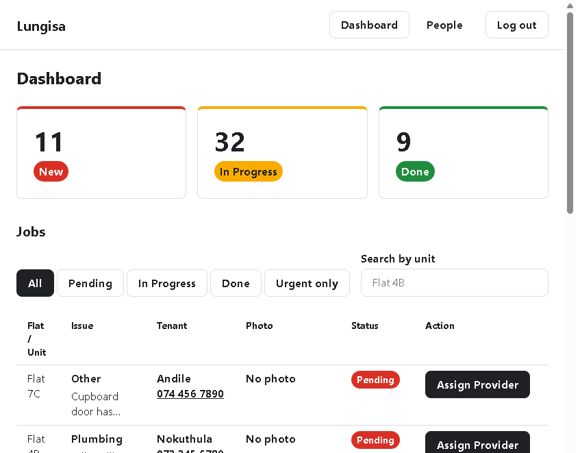
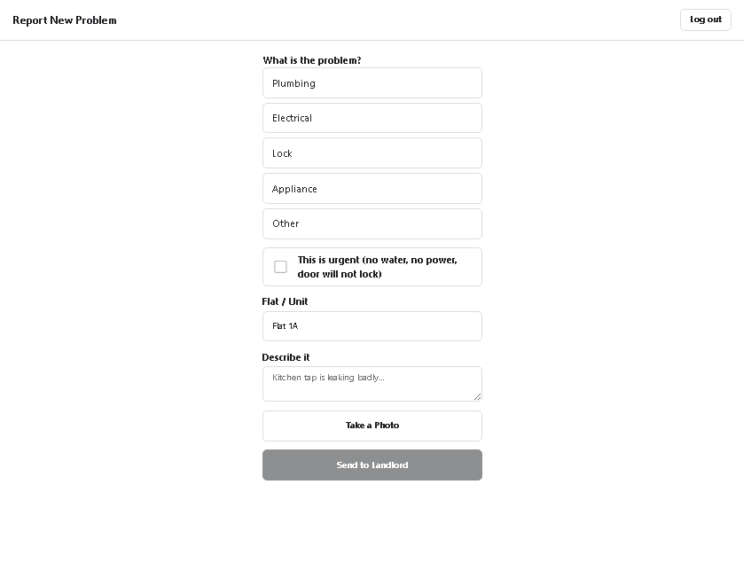
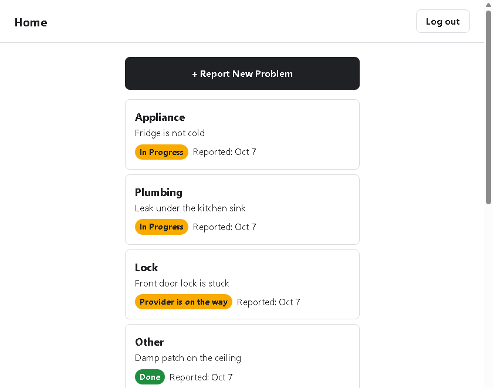

# Lungisa

**Status:** in progress (provider job actions and live updates are next).

Lungisa is a property maintenance app. A tenant reports a problem with a photo, the landlord assigns one of their providers, and the job moves through a fixed set of statuses until the work is done. Each person signs in with email and password and only sees their own data. The database enforces that, not just the screens.

The product spec is in [docs/PDR.md](docs/PDR.md). This file is how to run the project and what is built today.

## Screenshots







## How a job moves

| Status | Meaning | Who moves it |
| --- | --- | --- |
| Pending | Reported, nobody assigned yet | Created by the tenant |
| Assigned | A provider has been chosen | Landlord, with Assign Now |
| On the way | The provider has started | Provider |
| Done | Proof photo saved | Provider |

Two extra moves are allowed:

- **Reassign.** While the job is still Assigned, the landlord can switch to another of their own providers. The status stays Assigned. The history records a line such as "Reassigned from Sipho to Themba".
- **Not fixed.** On a finished job, the tenant can send it back to Assigned for the same provider, with a short note. It can be used once after each completion.

Every other skip or backwards move is rejected by a database trigger. Each change is written to `job_events`.

Assigning is guarded. The update only succeeds if the job is still Pending, so a second click or a second tab does not assign it again. The dashboard then shows "This job was already assigned". Reassign uses the same idea: the update only succeeds if the job is still Assigned to the provider shown in the window.

## Roles

| Role | Home | Can do |
| --- | --- | --- |
| Landlord | `/landlord` | See New, In Progress, and Done this month; filter and search jobs; assign and reassign; open a job's photos and timeline; add units; invite tenants and providers |
| Tenant | `/tenant` | Report a problem with a required photo and an optional Urgent flag; see only their own requests; mark a finished job Not fixed |
| Provider | `/provider` | See jobs assigned to them that are not finished, including the Urgent tag |

After login the app sends each role to its own area. Opening another role's URL sends the person back. Row Level Security is what actually stops one person reading or changing another's rows.

Nobody self-registers. The landlord invites tenants (tied to a unit) and providers (tied to a trade) by email.

## What is built

**Landlord.** Stat cards from one `landlord_stats()` call. Jobs table with unit, issue, tenant name and phone, photo thumbnail, status, and action. Pending jobs offer Assign Provider. Other jobs offer View Details, and Assigned jobs also offer Reassign. Filters are All, Pending, In Progress, Done, and Urgent only, plus a unit search. The table loads 20 rows at a time, pending first, then newest. Job details show the people, both photos when they exist, and the status timeline.

**Tenant.** Home list, report form (category, read-only unit, description, camera, Urgent checkbox), request details, and Not fixed.

**Provider.** A list of open jobs with category, description, status, and the Urgent tag. The database already allows the provider to mark a job on the way and done.

**Auth.** Login, forgot password, and reset password (at least 8 characters).

**Next.** Provider call, photo, "I am on my way", and proof upload, then live status updates. Payments, chat, and native apps stay outside this version and are described in the product spec.

## Tech stack

| Layer | Choice |
| --- | --- |
| UI | React 19, Vite 8 |
| Routing | React Router 7 |
| Server data | supabase-js and TanStack Query |
| Forms | React Hook Form and Zod, on the flows that need them |
| Photos | browser-image-compression, then Supabase Storage |
| Backend | Supabase Postgres, Auth, Storage, and the invite Edge Function |
| Styling | Plain CSS, with shared tokens in `src/app/tokens.css` |

The browser only receives the public anon key. The service role key is used by the seed script and the invite function, never by the React app.

## Requirements

- Node.js 20 or newer (the scripts use `node --env-file`)
- npm
- A Supabase project

## Local setup

1. Install dependencies.

   ```bash
   npm install
   ```

2. Copy the environment file and fill in the values from the Supabase project settings (Project URL and the anon public key). The service role key is under Project Settings, API. Keep it in `.env.local` only.

   ```bash
   copy .env.example .env.local
   ```

   On macOS or Linux, use `cp .env.example .env.local`.

3. Apply the SQL files in `supabase/migrations` in numeric order, from `0001_tables.sql` through `0013_reassign.sql`. The Supabase SQL editor is enough: open each file and run it once. Do not skip files. `0005_disable_rls.sql` turns Row Level Security off so the next steps can write rows, and `0007_rls.sql` turns it back on with the policies.

   If the Supabase CLI is already logged in and linked to this project, each file can also be run with:

   ```bash
   npx supabase db query --linked --project-ref <project-ref> -f supabase/migrations/0001_tables.sql
   ```

   Repeat that for every file, in order.

4. Deploy the invite function in `supabase/functions/invite-user` if you want the People page to send real invite emails. Invites also need the service role key configured as a secret on that function. The dashboard still loads without it.

5. Load the local sample data. This creates the landlord, three tenants, three providers, units, and about 50 jobs. It needs all three environment variables.

   ```bash
   node --env-file=.env.local scripts/seed.mjs
   ```

6. Start the app. Vite prints a local URL, usually `http://localhost:5173`.

   ```bash
   npm run dev
   ```

`.env.local` is gitignored. Do not commit real keys.

## Environment variables

| Name | Used by | Purpose |
| --- | --- | --- |
| `VITE_SUPABASE_URL` | App, seed, security check | Supabase project URL |
| `VITE_SUPABASE_ANON_KEY` | App, seed, security check | Public key. Safe in the browser. |
| `SEED_SERVICE_ROLE_KEY` | `scripts/seed.mjs` only | Creates auth users and bypasses Row Level Security. Never import this into `src/`. |

## Seed logins

These accounts exist only after the seed script has run. Every password is `LungisaDev123`.

| Person | Role | Email |
| --- | --- | --- |
| Thandi | Landlord | `thandi@seed.lungisa.test` |
| Lerato | Tenant, Flat 1A | `lerato@seed.lungisa.test` |
| Nokuthula | Tenant, Flat 4B | `nokuthula@seed.lungisa.test` |
| Andile | Tenant, Flat 7C | `andile@seed.lungisa.test` |
| Sipho | Provider, plumber | `sipho@seed.lungisa.test` |
| Themba | Provider, electrician | `themba@seed.lungisa.test` |
| Jabu | Provider, locksmith | `jabu@seed.lungisa.test` |

Seed job photos point at `seed/placeholder.jpg`. A thumbnail or details photo for those rows can show "The photo could not be opened" because that path is not a real file in Storage. Photos uploaded from the report form use a real storage path and open normally.

## Scripts

| Command | What it does |
| --- | --- |
| `npm run dev` | Start the Vite dev server |
| `npm run build` | Production build into `dist/` |
| `npm run preview` | Serve the production build locally |
| `npm run lint` | Run oxlint |
| `npm run security:check` | Sign in as the seed users with the anon key and check that blocked reads and writes stay blocked |

`security:check` changes seed data. A passing run reopens one finished job and reassigns one assigned job, so the dashboard counts will move. It never reads the service role key. It needs `.env.local` and a database that already has the seed users and the latest migrations.

## Routes

| Path | Who |
| --- | --- |
| `/login` | Everyone |
| `/forgot-password` | Everyone |
| `/reset-password` | Everyone, after the email link |
| `/landlord` | Landlord dashboard |
| `/landlord/jobs/:jobId` | Landlord job details |
| `/landlord/people` | Units and invites |
| `/tenant` | Tenant home |
| `/tenant/report` | New report |
| `/tenant/requests/:jobId` | One request |
| `/provider` | Provider's open jobs |

`/` redirects to `/login`.

## Project layout

```text
src/
  app/            routes, role guard, colour and spacing tokens
  components/     buttons, status badge, modal, photo viewer, urgent tag
  features/
    auth/         login, session, password reset
    landlord/     dashboard, jobs table, assign modal, job details, people
    tenant/       home, report, request details
    provider/     open jobs list
  lib/            Supabase client, photos, status labels
supabase/
  migrations/     tables, triggers, Row Level Security, storage
  functions/      invite-user Edge Function
scripts/
  seed.mjs            local sample data
  security-check.mjs  role checks against the live project
docs/
  PDR.md          product requirements
```

Supabase calls for a screen live in that feature's `api.js`. Components ask TanStack Query to load and refresh those functions.

## Database

Main tables:

- `profiles` — one row per login. The id is the auth user id. Role is `landlord`, `tenant`, or `provider`.
- `properties` and `units` — buildings and flats owned by one landlord.
- `jobs` — one maintenance report. `landlord_id` is stored on the row so the dashboard does not have to join to know who owns it.
- `job_events` — one row per status change, and one row when a job is reassigned.
- `invites` — an email invitation that has not been accepted yet.

Photos live in two Storage buckets, `job-photos` and `proof-photos`. A job cannot be inserted with an empty `photo_path`.

Migrations, in the order they must be applied:

| File | What it adds |
| --- | --- |
| `0001_tables.sql` | Enums and tables |
| `0002_indexes.sql` | Indexes for the dashboard and lists |
| `0003_triggers_and_stats.sql` | Status trigger, history trigger, `landlord_stats()` |
| `0004_grants.sql` | Table grants for the API roles |
| `0005_disable_rls.sql` | Turns RLS off until policies exist |
| `0006_extra_columns.sql` | Urgent flag and event notes |
| `0007_rls.sql` | Turns RLS on and adds the policies |
| `0008_storage.sql` | Photo buckets and storage policies |
| `0009_report_photo_upload.sql` | Tenant report photo path rules |
| `0010_tenant_home.sql` | Tenant list access |
| `0011_not_fixed.sql` | Tenant reopen rules |
| `0012_invites_created_at.sql` | Invite timestamps |
| `0013_reassign.sql` | Landlord may change provider only while the job is Assigned |

Later files replace `enforce_job_status_change()` and `log_job_status_event()`. The version in `0013_reassign.sql` is the one the app expects.

Landlord counts come from `landlord_stats()`:

- **New** — jobs still Pending
- **In Progress** — Assigned plus On the way
- **Done** — jobs completed this calendar month

The jobs table does not download every row to compute those numbers.

## Security

Row Level Security is on for `profiles`, `properties`, `units`, `jobs`, `job_events`, and `invites`. A landlord reads and updates their own jobs. A tenant reads and creates only their own jobs, and can update a job only to send a finished one back. A provider reads and updates only jobs assigned to them. Storage policies follow the same split.

The status trigger is a second lock. Even a request that passes the policy cannot skip a status, assign someone else's provider, or reassign after the provider is on the way.

`npm run security:check` covers the main cases: a tenant cannot read another tenant's jobs, the provider list, or landlord stats; a provider cannot see unassigned jobs or update another provider's job; a job cannot be created with an empty photo or another tenant's id; reopen requires a note and only works on the tenant's own finished job; reassign works for the landlord on an Assigned job and is blocked for On the way, for another landlord's provider, and for a provider or a tenant.

## Colours

Status colours are the same on every screen, and the word is always shown with the colour.

| Status | Colour |
| --- | --- |
| Pending, and the Urgent tag | `#D93025` |
| Assigned, On the way, In Progress | `#F9AB00` |
| Done | `#1E8E3E` |

Landlord buttons are 40px tall. Provider buttons are 64px tall and full width, so they are usable outdoors on a phone.
